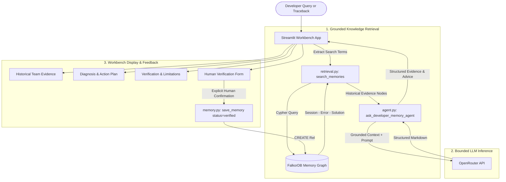
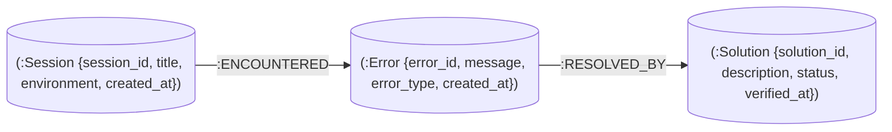
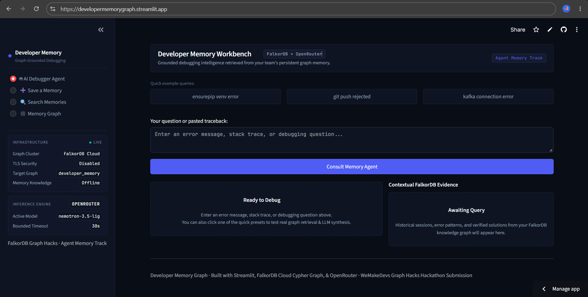
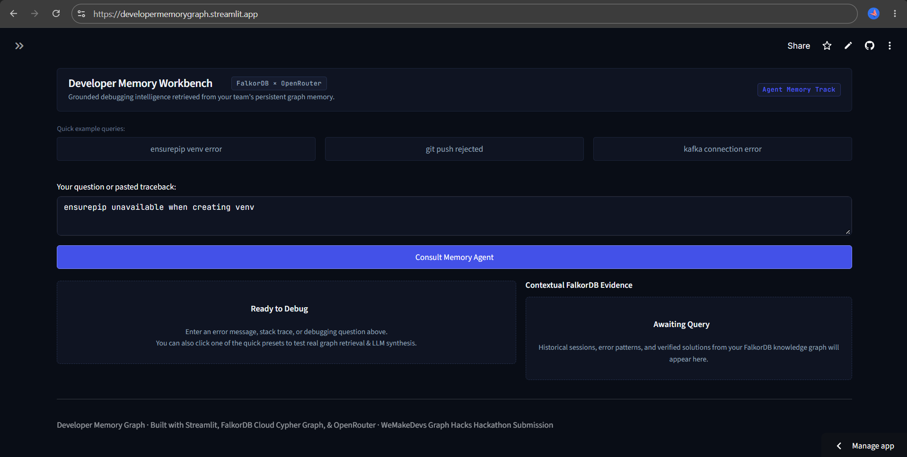
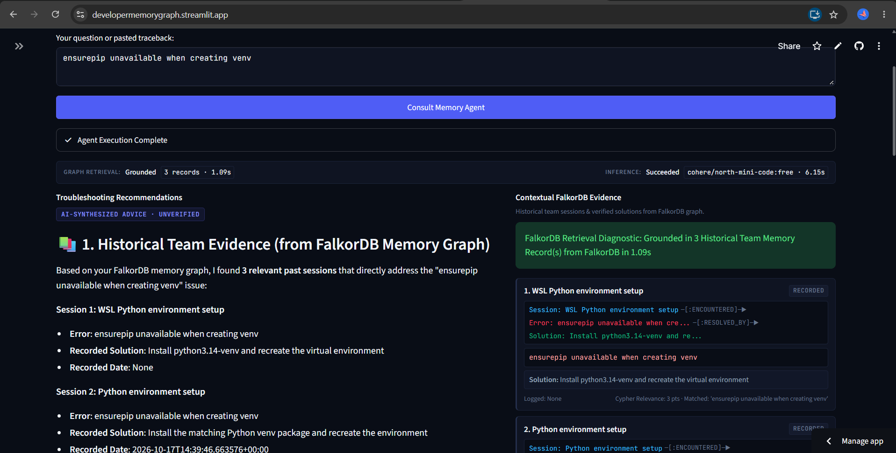
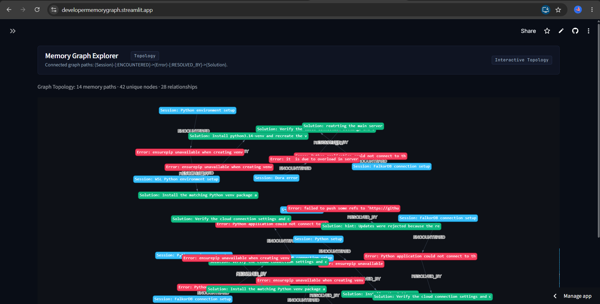
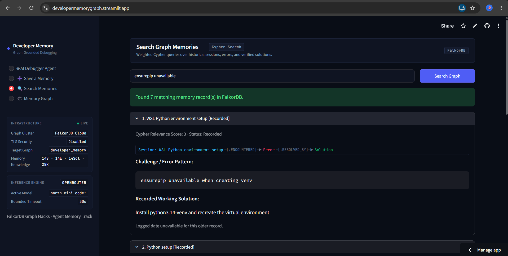

# Developer Memory Graph

**Persistent developer memory for AI-assisted debugging, powered by FalkorDB and OpenRouter.**

Developer Memory Graph is a specialized developer workbench built with Streamlit that stores debugging sessions, encountered errors, and verified solutions in a FalkorDB knowledge graph. When a developer encounters an issue or traceback, the AI agent searches historical team memories in the graph before synthesizing troubleshooting recommendations.

---

## 1. Problem Statement

Developers repeatedly encounter identical or similar errors—such as environment misconfigurations, dependency conflicts, or deployment failures—yet the root cause context and verified fixes are often lost across fragmented chat threads, terminal histories, or local notes.

When developers consult general-purpose AI assistants, those models respond in a vacuum without knowing what specific architecture, constraints, or verified workarounds previously worked for the team.

**Developer Memory Graph** bridges this gap:
- Captures development sessions, errors, and fixes as connected graph entities.
- Grounds AI debugging recommendations in historical team evidence from FalkorDB.
- Explicitly separates recorded team evidence from unverified AI advice.
- Enforces human-in-the-loop verification before marking a solution as verified.

---

## 2. Key Features & Technology Stack

### Key Features
- **AI Developer Memory Agent:** Consult an LLM grounded in real team memories retrieved from FalkorDB.
- **Evidence vs. Recommendation Separation:** Clearly demarcated UI sections showing historical graph facts versus generated advice.
- **Human Verification Workflow:** Solutions are recorded as unverified (`status="recorded"`) by default and only elevated to `status="verified"` upon explicit developer confirmation.
- **Interactive Graph Visualization:** Visual inspection of Session, Error, and Solution nodes and their relationships via `streamlit-agraph`.
- **Search Memories:** Targeted keyword and error-search interface over existing knowledge records.
- **Resilient Infrastructure & Telemetry:** Dual configuration loading (Streamlit Community Cloud Secrets with `.env` fallback), bounded timeout enforcement (5–120s), independent error diagnosis, and zero-credential leak protection.

### Technology Stack
- **Frontend & UI:** [Streamlit](https://streamlit.io/) (`streamlit==1.66.0`), [streamlit-agraph](https://github.com/ChrisChross/streamlit-agraph) (`0.0.45`)
- **Knowledge Graph Database:** [FalkorDB Cloud](https://falkordb.com/) via `falkordb==1.8.0` and `redis==8.1.0`
- **LLM Reasoning & Inference:** [OpenRouter API](https://openrouter.ai/) (default: `nvidia/nemotron-3.5-lightning:free` or `cohere/north-mini-code:free`)
- **Networking & Data Processing:** `requests==2.34.2`, `pandas==3.0.6`, `networkx==3.7`, `python-dotenv==1.2.4`
- **Language & Runtime:** Python 3.12+ / Python 3.14 on Linux/WSL

---

## 3. Architecture



---

## 4. Graph Data Model

The graph structure in FalkorDB links development sessions, encountered errors, and resolved solutions:



### Node Types
- **`Session`**: The development task, setup context, or sprint objective (e.g., `WSL Python environment setup`, `Git deployment`).
- **`Error`**: The specific error string, exception class, or traceback encountered during the session.
- **`Solution`**: The actionable remediation steps, commands, or configuration changes. Includes a `status` field:
  - `status = "recorded"`: Default status when newly saved.
  - `status = "verified"`: Explicitly set only after a developer confirms the solution worked.

### Relationships
- `(:Session)-[:ENCOUNTERED]->(:Error)`: Captures the error that occurred in the context of a particular session.
- `(:Error)-[:RESOLVED_BY]->(:Solution)`: Connects the error directly to the resolution that fixed it.

---

## 5. Historical Evidence vs. Unverified AI Advice

To ensure high engineering trust, the workbench clearly distinguishes between:

1. **Retrieved Historical Evidence (from FalkorDB Memory Graph):**
   - Grounded facts retrieved using full-text and pattern matching from past team records.
   - Shows the exact session name, recorded error, recorded solution, and timestamp.
   - If no historical matches are found, the agent explicitly states:
     `⚠️ No relevant historical records found in your FalkorDB memory graph for this specific issue.`
2. **AI-Generated Troubleshooting Plan:**
   - Synthesized advice produced by the LLM based on the user's prompt and any retrieved graph context.
   - Accompanied by environment caveats, manual verification reminders, and safe copyable commands.
   - Unverified advice is never marked as verified in the graph until a human developer tests it and confirms it in the workbench UI.

---

## 6. Screenshot Gallery

> **Note:** The images below are documentation placeholders for the workbench UI and will be populated with interface captures upon deployment:

### Main Workbench Dashboard

*Figure 1: Developer Memory Workbench dashboard showing system status, connection telemetry, and workspace navigation (placeholder).*

### AI Debugger & Query Interface

*Figure 2: Query input interface where developers paste terminal errors or tracebacks for grounded analysis (placeholder).*

### Grounded Historical Evidence Display

*Figure 3: Demarcated evidence section displaying matching past session records and verification states from FalkorDB (placeholder).*

### Interactive Knowledge Graph Explorer

*Figure 4: Visual exploration of Session, Error, and Solution nodes and their relationships rendered via streamlit-agraph (placeholder).*

### Search Memories Interface

*Figure 5: Targeted memory search allowing developers to browse and filter past solutions (placeholder).*

---

## 7. Local Setup & Run Instructions

### Prerequisites
- Python 3.12 or compatible version
- Access to a FalkorDB instance (such as FalkorDB Cloud)
- An OpenRouter API key

### 1. Clone Repository
```bash
git clone https://github.com/<YOUR_ORGANIZATION_OR_USERNAME>/developer-memory-graph.git
cd developer-memory-graph
```

### 2. Create and Activate Virtual Environment
On Linux or WSL:
```bash
python3 -m venv .venv
source .venv/bin/activate
```

> **Note for Ubuntu/Debian users:** If `ensurepip` is missing, run `sudo apt update && sudo apt install python3-venv` and recreate the environment.

### 3. Install Dependencies
```bash
pip install -r requirements.txt
```

### 4. Configure Environment Variables
Copy the template and configure your parameters:
```bash
cp .env.example .env
```
Populate `.env` with your FalkorDB Cloud credentials and OpenRouter key (see Section 9 for variable definitions).

### 5. Launch the Streamlit App
```bash
streamlit run app.py
```
Open `http://localhost:8501` in your browser.

---

## 8. Streamlit Community Cloud Deployment

Developer Memory Graph is pre-configured to deploy seamlessly to **Streamlit Community Cloud** with native support for `st.secrets`:

1. **Push Repository to GitHub:** Ensure your repository is on GitHub with `.env` properly excluded by `.gitignore`.
2. **Create New App on Streamlit Cloud:**
   - Sign in to [share.streamlit.io](https://share.streamlit.io/).
   - Select your repository and branch (`main`).
   - Set the main file path to `app.py`.
3. **Configure Secrets in Streamlit Dashboard:**
   - Under **App Settings** > **Secrets**, enter your configuration in TOML format:
     ```toml
     FALKORDB_HOST = "your-instance.falkordb.cloud"
     FALKORDB_PORT = "6379"
     FALKORDB_USERNAME = "default"
     FALKORDB_PASSWORD = "your-database-password"
     FALKORDB_TLS = "true"

     OPENROUTER_API_KEY = "sk-or-v1-your-key-here"
     OPENROUTER_MODEL = "nvidia/nemotron-3.5-lightning:free"
     OPENROUTER_TIMEOUT = "30"
     ```
4. **Deploy:** Click **Deploy**. Streamlit Cloud automatically reads secrets via `st.secrets` while keeping credentials out of source control.

---

## 9. Environment Variables & Secrets Reference

The application reads configuration through a unified getter (`get_config_var`), which checks **Streamlit Secrets** first, then falls back to **`.env` / `os.environ`**:

| Variable Name | Required | Default | Description |
| :--- | :--- | :--- | :--- |
| `FALKORDB_HOST` | Yes | `localhost` | Hostname or IP of the FalkorDB instance / cluster. |
| `FALKORDB_PORT` | No | `6379` | Port for FalkorDB / Redis connection. |
| `FALKORDB_USERNAME` | No | `default` | FalkorDB database user. |
| `FALKORDB_PASSWORD` | Yes | *(None)* | Secure password or token for FalkorDB authentication. |
| `FALKORDB_TLS` | No | `false` | Enable TLS/SSL connection (`true` / `false`). Recommended for cloud deployments. |
| `OPENROUTER_API_KEY` | Yes | *(None)* | OpenRouter API authentication key (`sk-or-v1-...`). |
| `OPENROUTER_MODEL` | No | `nvidia/nemotron-3.5-lightning:free` | Model identifier to use on OpenRouter (e.g. `cohere/north-mini-code:free`). |
| `OPENROUTER_TIMEOUT` | No | `30` | Request timeout in seconds (strictly bounded between `5.0` and `120.0`s). |

> **Security Reminder:** Never commit `.env` or paste real credentials into issues, pull requests, or screenshots.

---

## 10. Testing

The repository contains an isolated, non-destructive test suite that verifies timeout handling, credential scrubbing, secret precedence, and loading states without writing to live FalkorDB or making billable API calls:

```bash
.venv/bin/python -m unittest test_timeout_handling.py -v
```

### Latest Verified Results
- **Total Tests:** 28 passed
- **Status:** `OK` (0 failures, 0 errors)
- **Key Test Coverage Areas:**
  - `get_config_var` Streamlit secrets precedence over `os.environ`
  - Fallback to `.env` and defaults outside Streamlit runtime
  - FalkorDB connection parameter parsing from secrets
  - Bounded request timeout enforcement (`MIN=5.0s`, `MAX=120.0s`)
  - Redaction of API keys and passwords in diagnostic error logs
  - Independent reporting of FalkorDB retrieval vs. OpenRouter inference
  - Safe default status (`"recorded"`) and explicit confirmation (`"verified"`) on memory saves
  - Streamlit `AppTest` lifecycle: clean clearance of loading state on timeout or unhandled exception

To verify code compilation across the project:
```bash
.venv/bin/python -m py_compile app.py agent.py db.py memory.py retrieval.py test_timeout_handling.py
```

---

## 11. Repository Structure, Limitations & Attribution

### Repository Structure
```text
developer-memory-graph/
├── .env.example             # Template for local environment variables
├── .gitignore               # Excludes .env, virtual environments, and caches
├── README.md                # Project documentation and deployment guide
├── requirements.txt         # Pinned runtime dependencies
├── app.py                   # Streamlit multi-tab developer workbench UI
├── db.py                    # FalkorDB connection manager & get_config_var helper
├── agent.py                 # Grounded retrieval agent, OpenRouter client, & sanitizers
├── memory.py                # Graph node & relationship creation (save_memory)
├── retrieval.py             # Memory retrieval, full-text search & graph statistics
└── test_timeout_handling.py # Comprehensive unit & regression test suite (28 tests)
```

### Current Limitations
- **Full-Text Graph Search:** Keyword extraction currently operates on regex-parsed technology terms and cypher string filters; semantic vector embeddings can be added in future iterations.
- **Upstream Model Availability:** OpenRouter free-tier models may experience transient queuing or rate limits during peak usage. The application handles this with bounded socket timeouts and retry controls.
- **Graph Pruning:** Graph memory grows monotonically; automated deduplication or merging of identical solutions across sessions is a planned enhancement.

### Hackathon Attribution
Built for the **WeMakeDevs × FalkorDB Graph Hacks: Context for AI Agents** hackathon under the **Agent Memory and Coordination** track.
